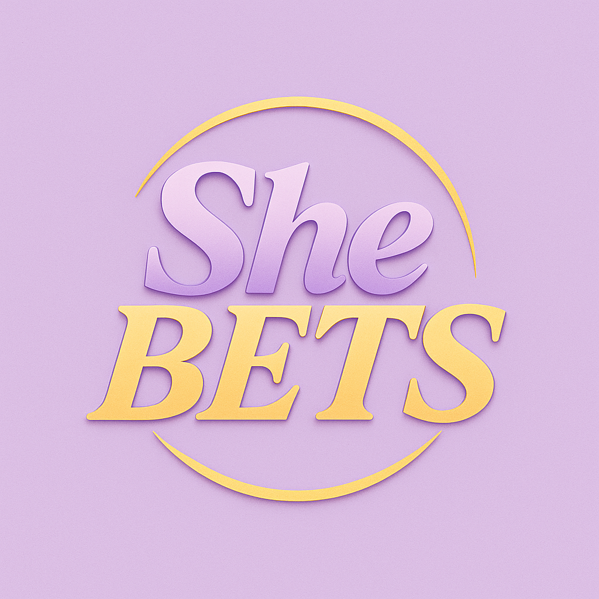

<p align="center">
  
</p>

# SheBETS Classic

I love sports, especially basketball, and wanted to build something that let me
make NBA predictions, track my picks, and see how I did over a full season.
That's where SheBETS started.

SheBETS Classic is my NBA prediction and virtual-betting app. I built the first
version for the 2025-26 season, then expanded it for 2026-27 while keeping my
original results intact. It's a personal project that brings together my
interest in basketball and my work with Python, full-stack development, and data.

**All wagers use virtual money.** There are no deposits, payments, or real-money
bets. The app is currently built for private, local, single-user use.

## What You Can Do

- **Browse NBA games one day at a time.** Start with today's games, move backward
  or forward, or choose a date. Game times use America/Chicago and are labeled CST/CDT.
- **Make your picks.** Select a game, choose a winner, enter a virtual wager, and
  click **Place My Pick**. A success message shows your pick and updated bankroll.
- **Follow your bankroll.** Both seasons start with $5,000 in virtual money.
  The 2026-27 season is active; 2025-26 is a separate, read-only archive.
- **Check results when you're ready.** Use **Refresh Results / Settle Eligible
  Bets** in My Picks to check pending games and update completed picks. Settlement
  is manual: one click checks all pending games until the pass finishes or the
  provider asks it to stop. The summary shows wins, losses, refunds, and picks still open.
- **See how you're doing.** View open and settled picks, wins and losses,
  profit/loss, win percentage, ROI, and performance charts. Download CSV copies
  of your records and available saved schedules/results.

Picks use **fixed even-money payouts**, not live sportsbook odds. For example,
a $50 winning pick returns $100 total: your $50 stake plus $50 profit. A loss
returns nothing. Wagers must fit your available bankroll, with a $5,000 per-pick
limit. Postponed games stay pending; verified cancellations return the stake.

The interface uses my original SheBETS logo and lavender and gold styling.
My local installation can display collected NBA team images, with abbreviation
badges when an image is missing. These optional images aren't distributed with
the repository because their redistribution rights haven't been verified.
See [local logo notes](docs/local-team-logos.md).

## Screenshots

**Screenshots coming soon.** I plan to add views of the dashboard, daily NBA
games, and My Picks. There aren't any app screenshots in this repository yet.

## How I Built It

I used **Python** throughout the project. **Streamlit** handles the interface,
**FastAPI** handles the app's requests and betting checks, and **BALLDONTLIE**
supplies NBA game data. Picks and wallet balances are saved locally in CSV and
JSON files. Performance charts use Plotly.

Some of the most interesting work happened behind the screens:

- **Keeping seasons separate.** I added a new season without resetting the old
  one. The app blocks changes to the archive and keeps each season's records separate.
- **Making each pick count once.** If a click is repeated or a response gets
  lost, retrying the same submission shouldn't deduct the wager twice.
- **Using game data carefully.** The app reuses recently fetched schedules to
  reduce API requests and waits when the provider asks it to slow down. Before
  accepting a pick or settling a result, it makes a fresh check. An older schedule
  can still be displayed with a warning, but can't approve a bet.
- **Testing without touching my records.** Tests create invented seasons,
  wallets, and games in temporary folders. They cover betting, settlement,
  navigation, season protection, and API request limits without placing live picks.

For more detail, see the [daily-games notes](docs/daily-games.md),
[API request audit](docs/provider-request-audit.md), and
[season-preservation guide](docs/preservation.md).

## Getting Started

You'll need **Python 3.12** and your own BALLDONTLIE API key for live games and
verification. Provider access and rate limits depend on your account.

Run the following commands from the repository root. These examples use PowerShell.

### Install the dependencies

```powershell
python -m venv venv
.\venv\Scripts\Activate.ps1
python -m pip install -r requirements.txt
```

On macOS/Linux, use this activation command instead:

```bash
source venv/bin/activate
```

### Add your API key

Create a private `.env` file in the repository root:

```dotenv
NBA_API_KEY=replace_with_your_own_key
NBA_API_BASE_URL=https://api.balldontlie.io/v1/games
APP_TIMEZONE=America/Chicago
```

The default API URL and timezone are shown above. The current daily schedule
and interface use America/Chicago. Keep your real key out of GitHub.

### Set up a new season

For a new installation with no existing 2026-27 season folder, run:

```powershell
python scripts/initialize_season_storage.py initialize-new
```

This creates an empty season with a $5,000 wallet. It refuses to overwrite an
existing folder. If you already have saved seasons, keep them and their private
backups; don't delete or reset them to repeat setup.

Saved records live under `data/seasons/` and aren't included in GitHub. A fresh
clone won't include my 2025-26 archive. That view needs a privately restored
archive; otherwise it reports that the data is missing. The
[preservation guide](docs/preservation.md) explains the separate archive tools.

### Start the app

Start FastAPI from the repository root:

```powershell
python -m uvicorn backend.api.main:app --reload --host 127.0.0.1 --port 8000
```

In a second terminal, activate the same environment and start Streamlit:

```powershell
.\venv\Scripts\Activate.ps1
python -m streamlit run streamlit_app.py --server.address 127.0.0.1
```

Open [SheBETS locally](http://127.0.0.1:8501). You can also view the
[API documentation](http://127.0.0.1:8000/docs) or
[health check](http://127.0.0.1:8000/health) while the backend is running.
Keep both services local; the app doesn't have user accounts or authentication.

If you need different local addresses or storage, set these optional environment
variables in the terminal running the relevant service:

| Variable | What it changes |
| --- | --- |
| `SHEBETS_API_URL` | Streamlit's backend address; defaults to `http://127.0.0.1:8000`. |
| `SHEBETS_SEASONS_ROOT` | The backend's season-storage location; defaults to `data/seasons/` in this project. |

Streamlit doesn't load `.env` itself, so set its optional variable in the frontend
terminal. Betting and settlement safety switches are defined in
`backend/api/core/config.py`, rather than environment variables.

### Run the tests

```powershell
python -m unittest discover -s tests -v
```

The suite runs without an API key or personal betting files. On Windows, the
symlink test may be skipped if the account can't create symlinks.

API outages or incomplete game data can temporarily prevent picks or leave
results pending. Historical charts group returns by the date a pick was placed,
since the original records didn't include exact settlement times.

**Keep personal data private:** API credentials, wallets, betting histories,
archives, and recovery files don't belong in GitHub. The ignore rules protect
the project's local data and secrets, but those files still need private backups.

## What's Next

I'd like to add GitHub CI checks and verify permissions before distributing
team artwork. For now, Classic stays focused on NBA winner picks and
tracking a season's performance.

I'm also considering a separate **SheBETS 2.0** with accounts, leaderboards,
spreads and totals, explanations of betting terms, and an AI sports analyst.
Those are future ideas, not features of the current app. I want to explore them
without losing the original project I've enjoyed building.
